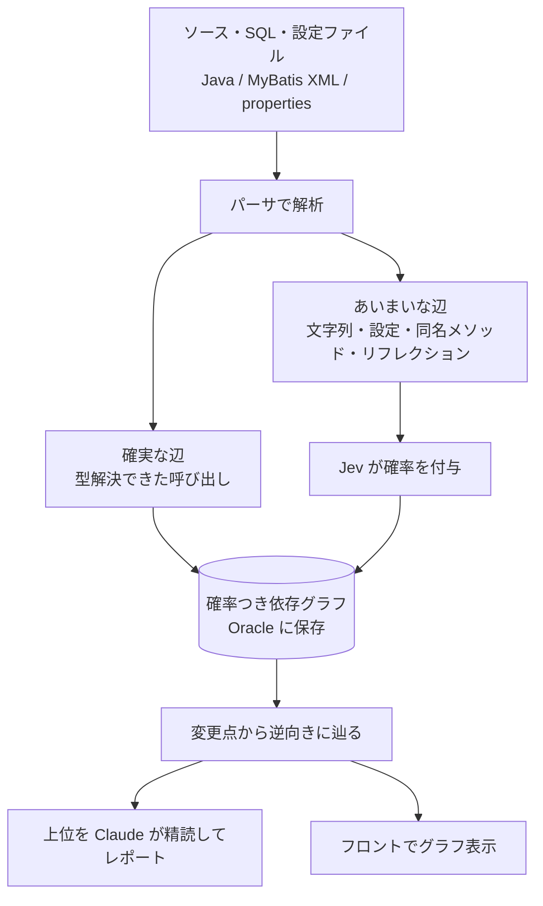
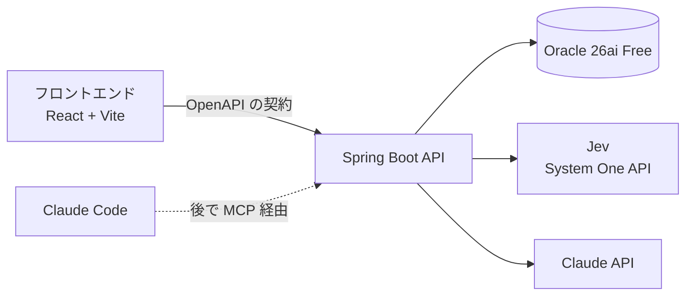

# hamon（波紋）構想メモ

最終更新: 2026-10-31

## ひとことで

Java + Oracle のシステムを対象にした **「確率つき影響調査ツール」**。
変更点を指定すると、影響を受けそうな箇所が「確からしさ」順に並び、依存関係がグラフとして画面に広がる。

**名前の由来**：変更は池に投げ込んだ石、影響はそこから広がる波紋、確率は波の強さ。

## このプロジェクトの 3 つの目的

| # | 目的 | 中身 |
|---|------|------|
| 1 | 道具 | 影響調査の「漏れ」を減らす。AI だけでは苦手だった部分を、静的解析 + Jev + Claude の分業で補う |
| 2 | 学習 | Spring Boot と API セントリックな開発に慣れる（これまでは 2000 年頃のオレオレフレームワークのみ） |
| 3 | 楽しさ | 依存関係がグラフで広がっていくのを眺める。見た目も楽しむ |

ツールを作ること自体を Spring の教材にする。「Spring を勉強してから調査ツール」ではなく、**調査ツールを作りながら Spring に慣れる**。

---

## 背景・問題意識

### AI が影響調査で漏らす理由

- LLM はコードベース全体を漏れなく読めない。それっぽい呼び出し元を挙げて「たぶんこれで全部」と言ってしまう
- 影響調査で一番怖いのは「漏れ」なので、相性が悪い

### 既存のもの：GitLab Knowledge Graph（現 Orbit）

- コードを tree-sitter などで解析し、ファイル・クラス・関数とその関係（import・呼び出し・継承）を組み込み型グラフ DB に保存。MCP 経由で AI エージェントから問い合わせる
- 想定用途に影響分析も含まれる
- ただし「各言語のコンパイラの精度を完全に再現するつもりはない」と明言している → 辺には「確実」と「たぶん」が混ざる

### 自作する意味（差別化ポイント）

1. **辺に確率を持たせる**：あいまいな辺に Jev で確率を付け、「確率つき依存グラフ」にする。影響調査は変更点から逆向きに辿って、経路上の確率を掛け合わせて並べるだけ
2. **コード以外もノードにする**：SI の影響調査で本当に辛いのは「このテーブルのカラムを変えたら、どの SQL・どの画面・どのバッチに響くか」。テーブル・カラム・SQL・設定キーもノードに入れる

---

## 仕組み（全体像）



### システム構成



---

## Jev の使いどころ

### 役割分担

| 担当 | やること | 性格 |
|------|----------|------|
| 静的解析 | 漏れのない候補を機械的に出す | 確実・速い・意味は分からない |
| Jev（System One） | あいまいな辺を 1 本ずつ判定し確率を付ける | 速い・安い・大量に回せる |
| Claude（System Two） | 確率上位だけ精読し、何をテストすべきかまでレポートにする | 遅い・高い・深く考えられる |

### 質問設計の例

| 対象 | 型 | 質問 |
|------|----|------|
| あいまいな辺 | Noul（yes/no の確率） | 候補のコードは、変更されたメソッド／カラムを実際に使っているか |
| 影響の種類 | Choice（選択） | 呼び出し／データ形式／挙動／設定 のどれか |
| 深刻度 | Score（採点） | 壊れたときの影響の大きさ |

リクエストのイメージ（`noul` 以外の書き方は公式 API リファレンスで要確認）:

```json
{
  "model": "jev-1.13.0",
  "state": "【変更】OrderService#cancel に引数 reason を追加\n【候補】BatchJob.java 42行目: invoker.invoke(\"cancel\", order)\n【補足】invoker はメソッド名の文字列で呼び出し先を決める",
  "questions": {
    "affected": {
      "type": "noul",
      "instructions": "候補のコードは、変更されたメソッドを実際に呼び出しているか？"
    }
  }
}
```

- エンドポイント: `POST https://api.typesafe.ai/v1/systemone`（`Authorization: Bearer $TYPESAFE_API_KEY`）
- 必須フィールドは `model` / `state` / `questions` の 3 つ
- **ただの HTTP API なので、Java から Spring の `RestClient` で直接呼べる**（SDK 不要）。Python は試し打ち用

### 設計のポイント

- `state` に何を詰めるかが精度のすべて。変更差分・候補のコード片・呼び出し関係の要約をセットで渡す
- 確率は経路に沿って掛け合わせる（まずは単純な積でよい）
- 確率がキャリブレーションされている前提で、「5% 以上は人間に見せる」のように**漏れの許容度を数字で決める**。これが従来の AI 影響調査にはなかった価値

### 注意点

- 「幻覚しない」は出力形式の話。答えが正しい保証ではない
- 精度・速度・価格の数字は 2026-10 時点で TypeSafe 自身の発表のみ。自分のリポジトリで確かめる価値がある
- アーリーアクセス。モデルは更新されるので、ID はピン留めして判定ログに残す（2026-09 時点: `jev-latest` → `jev-1.13.0`）

---

## 技術スタック（暫定）

| 領域 | 選択 | メモ |
|------|------|------|
| 言語 | Java 25（LTS） | |
| フレームワーク | Spring Boot 4 系 | Spring Initializr が出す最新安定版を使う。Boot 4 は Java 17〜25 対応 |
| ビルド | Gradle（Wrapper、Groovy DSL） | 開発者の好みで決定（2026-10-31）。`./gradlew` を使う |
| API | OpenAPI スキーマファースト | ルートの `openapi.yaml` が契約。サーバーは openapi-generator（Gradle プラグイン、`spring` 生成器）でインターフェースを生成、フロントは openapi-typescript で型を生成し openapi-fetch で呼ぶ |
| DB | Oracle AI Database 26ai Free | Dev Container 内のコンテナ |
| データアクセス | MyBatis（まず）→ Spring Data JDBC（比較） | ADR-0001。マイグレーションは Flyway |
| フロント | React + Vite + TypeScript | `frontend/`。グラフ描画は Cytoscape.js。TypeScript は openapi-typescript の都合で 5 系に固定 |
| 解析 | JavaParser + symbol solver（ADR-0002） | MyBatis XML は XML として、SQL は SQL パーサで（Phase 4） |
| Jev | REST API 直叩き | `TYPESAFE_API_KEY` はリポジトリ直下の `.env`（git 管理外）からコンテナの環境変数として渡す |
| 開発環境 | Linux Mint + Docker Engine + VS Code + Dev Container + Claude Code | `.devcontainer/` 参照 |

---

## API セントリック開発の考え方（学習メモ）

### 「yaml で定義を書いて、それを受け入れる」の正体

これは **OpenAPI のスキーマファースト**開発。流れは:

1. `openapi.yaml` に API の契約（URL・パラメータ・レスポンスの形）を書く
2. サーバー側：openapi-generator で Spring のインターフェースを生成し、それを実装する
3. フロント側：同じ yaml から型付きの API クライアントを生成する

契約が 1 か所にまとまるので、サーバーとフロントがずれない。

### 旧来のフレームワークとの違い

- 旧来：画面とロジックが一体。サーバーが HTML を返す
- API セントリック：**API が境界**。サーバーは JSON を返すだけ、画面はフロントが担当。同じ API を画面・CLI・Claude（MCP）から使い回せる

### 最初の API はこのくらいで十分

```yaml
openapi: 3.0.3
info:
  title: hamon API
  version: 0.1.0
paths:
  /impact:
    get:
      summary: 指定したノードを変更したときの影響範囲
      parameters:
        - name: target
          in: query
          required: true
          schema:
            type: string
          example: com.example.order.OrderService#cancel
        - name: minProbability
          in: query
          schema:
            type: number
            default: 0.05
      responses:
        "200":
          description: 影響を受ける候補（確からしさ順）
          content:
            application/json:
              schema:
                type: array
                items:
                  $ref: "#/components/schemas/ImpactItem"
components:
  schemas:
    ImpactItem:
      type: object
      properties:
        node:
          type: string
        probability:
          type: number
        path:
          type: array
          items:
            type: string
```

### 「自分の Spring ベースのフレームワークを作る？」について

**結論：最初は作らない。** Spring Boot 自体がすでに「毛を生やしたフレームワーク」なので、まずは Spring のお作法に乗る。

- 共通処理を書きたくなったら、まず Spring の標準の仕組みで書けるか確認する（例外処理 → `@RestControllerAdvice`、横断的な処理 → Filter / AOP、設定 → `@ConfigurationProperties`）
- オレオレ欲は、慣れてきてから「OpenAPI 生成テンプレートの調整」や「解析パイプラインのプラグイン構造」に向けると健全

---

## ロードマップ

各フェーズで「Spring で学べること」と「ツールとしてできること」が両方前に進むように組む。

| Phase | テーマ | Spring・API で学べること | ツールとしてできること |
|-------|--------|--------------------------|------------------------|
| 0 | 環境 | Dev Container、Spring Initializr、`./gradlew bootRun` | Hello World が返る。Oracle に接続できる |
| 1 | API とグラフ表示 | OpenAPI スキーマファースト、Controller、DI、テスト | ダミーのグラフがブラウザに広がる（ここで早めに楽しむ） |
| 2 | Oracle に保存 | データアクセス、トランザクション、DB マイグレーション（Flyway など） | ノード・辺のテーブル。再帰 SQL で逆向きに辿れる |
| 3 | Java を解析 | 設定値の扱い、バッチ的な処理 | **このリポジトリ自身**を解析してグラフにする（自分のコードで試せる） |
| 4 | SQL・テーブルもノードに | MyBatis（採用すれば）、XML の扱い | 「このカラムを変えたら？」に答えられる。SI らしい影響調査 |
| 5 | Jev で確率付け | 外部 API 呼び出し（`RestClient`）、リトライ、ログ | あいまいな辺に確率。閾値で人間が見る範囲を決める |
| 6 | Claude でレポート / MCP 化 | API の再利用 | Claude Code から「この変更の影響は？」と聞ける |
| 後で | 影響範囲が見えるエディタ | — | 下の「後回しアイデア」参照 |

### 現在地

- [x] アイデア整理（このメモ）
- [x] 名前決定：hamon
- [x] Dev Container 定義（Java 25 + Node + Oracle 26ai Free、Jev のキーは .env から）
- [x] Phase 0：Spring Initializr でプロジェクト作成（Boot 4.1.2 / Java 25 / Gradle）、`/hello` と `/actuator/health` で Oracle 接続確認（2026-10-31）
- [x] Phase 1：`openapi.yaml` → 生成 → `GET /api/impact`（固定のダミー候補）、React + Cytoscape でグラフ表示（2026-10-31）
- [x] Phase 2：Flyway で node / edge 表とサンプルグラフ、MyBatis + 再帰 SQL（WITH … CYCLE）で逆向きに辿る（2026-10-31、ADR-0001）
- [x] Phase 2b：Spring Data JDBC 版を追加し、プロファイル mybatis / datajdbc で切り替え。同じ統合テストが両方で通る（2026-10-31）
- [ ] Phase 2c：比較の結論を出し、片方に決める（別 ADR）
- [x] Phase 3：JavaParser で `src/main/java` を解析し、`POST /api/analysis` でグラフを作り直す。書き込みも MyBatis / Spring Data JDBC の両方（2026-10-31、ADR-0002）
- [ ] Phase 4：SQL・テーブル・カラムもノードに（MyBatis XML の解析）

---

## 未決事項

- **グラフの保存方式**：
  - Oracle の表 + 再帰 SQL（`WITH` 再帰 / `CONNECT BY`）… まずはこれ
  - Oracle の SQL Property Graph（23ai 以降の `GRAPH_TABLE`）… DB を増やさずにグラフクエリ。要検証
  - Neo4j … 見た目は一番楽しいが DB が 1 つ増える
- **解析対象のサンプル**：このリポジトリ自身 + SI っぽいサンプル（Spring + MyBatis + Oracle）

---

## 後回しアイデア置き場

- **影響範囲が見えるエディタ**：保存のたび（タイプが止まるたび）に差分を Jev に投げ、全関数の「影響を受ける確率」をガターにヒートマップ表示。Jev の応答は数百ミリ秒なので編集のリズムを壊さない。LLM では待ち時間的に無理だったこと
- **AI が書かないエディタ**：書くのは自分だけ。AI は余白にレビューコメントや質問を付けるだけ
- **「なぜ」が残るエディタ**：保存時に AI が差分から意図を聞き、コードの横に理由の履歴が積み上がる

---

## 参考

- [GitLab Knowledge Graph（GitLab Docs）](https://docs.gitlab.com/user/project/repository/knowledge_graph/)
- [GitLab Knowledge Graph First Iteration（設計 Epic）](https://gitlab.com/groups/gitlab-org/-/epics/17514)
- [Jev: TypeSafe's System One Model（DataCamp）](https://www.datacamp.com/ko/blog/system-one-models-jev)
- [System One model とは（Sanity）](https://www.sanity.io/glossary/system-one-model)
- [How to get access to Jev and an API key](https://flaviocopes.com/jev-api-key/)
- [Spring Boot のバージョンとサポート期限](https://www.herodevs.com/blog-posts/spring-boot-versions-eol-dates-and-latest-releases-april-2026)
- Jev の要件定義レビュー: https://qiita.com/miso_taku/items/b5e2150055933b51fba3
